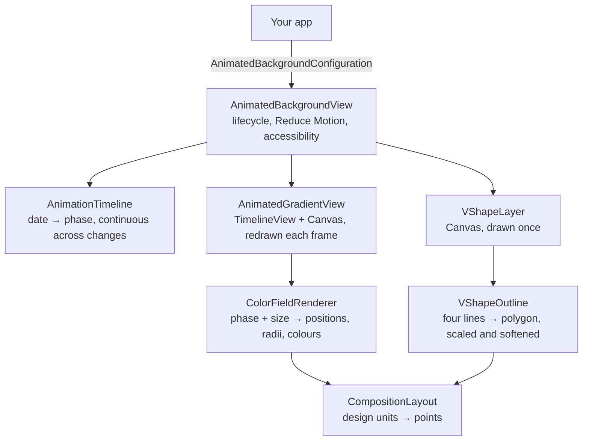

# Architecture

AnimationBGView is one view drawn from plain values. A configuration describes what to draw, a clock
turns time into a phase, pure functions turn a phase and a size into shapes, and two `Canvas` views
draw them. There is no view model, no shared mutable state, and no observable object: a
configuration is a value, so a parent view's `@State` is all an app needs.

- [Layers](#layers)
- [Rendering pipeline](#rendering-pipeline)
- [Configuration flow](#configuration-flow)
- [Animation lifecycle](#animation-lifecycle)
- [Public API](#public-api)
- [Decisions](#decisions)
- [Source layout](#source-layout)

---

## Layers



| Layer | Types | Responsibility |
|---|---|---|
| **Public API** | `AnimatedBackgroundView`, the configuration types, `AnimationPhase`, `VShape` | What apps use. Plain values with documented defaults |
| **Lifecycle** | `AnimatedBackgroundView`, `PlaybackMode`, `AnimationTimeline` | Decides whether the background is running, paused, or still, and keeps the phase continuous |
| **Geometry** | `CompositionLayout`, `VShapeOutline`, `GradientLight.center(at:travel:)`, `ColorFieldRenderer.resolvedLights` | Pure calculations from a phase and a size to shapes. No SwiftUI views involved |
| **Rendering** | `AnimatedGradientView`, `VShapeLayer`, `VShapeRenderer`, `GaussianFalloff` | Turns geometry into `Canvas` fills |

Everything below the public API is internal, so it can change without breaking apps.

---

## Rendering pipeline

Each frame of the lights:

1. `TimelineView(.animation(minimumInterval:paused:))` asks for a frame, at most `motion.frameRate`
   times a second.
2. The view reads the phase: the still phase if the background is still, or `timeline.phase(at: date)`.
3. `ColorFieldRenderer.resolvedLights` converts each `GradientLight` to a centre, a radius, and a
   colour in points, using `CompositionLayout`.
4. One `Canvas` fills the base colour, then fills four circles with radial gradients whose 12 stops
   follow a Gaussian.

The V is drawn separately:

1. `VShapeOutline` builds the V from four straight lines, scales them around the V's middle, and cuts
   the strokes off at the top edge.
2. `VShapeRenderer` fills four copies of the polygon, each offset a little along every edge's normal,
   with opacities chosen so the coverage ramps evenly across each edge.
3. This happens in its own `Canvas`, outside the `TimelineView`, and the view is `Equatable`, so it's
   only redrawn when the V's configuration or the size changes.

```text
┌───────────────────────── AnimatedBackgroundView (ZStack) ─────────────────────────┐
│  VShapeLayer           Canvas, drawn once           the V, base colour at 58%     │
│  AnimatedGradientView  TimelineView → Canvas        base fill + 4 radial fills    │
└────────────────────────────────────────────────────────────────────────────────────┘
```

---

## Configuration flow

`AnimatedBackgroundConfiguration` groups four parts, each a value type with its own defaults:

| Part | Type | Holds |
|---|---|---|
| `palette` | `BackgroundColorPalette` | The base colour, one colour per light, the V's colour |
| `motion` | `AnimationConfiguration` | Cycle length, speed, travel, frame rate, still phase, Reduce Motion behaviour, pausing |
| `vShape` | `VShapeConfiguration` | Visibility, opacity, scale, edge softness, geometry |
| `gradient` | `GradientConfiguration` | The lights' paths, sizes, and opacities, plus intensity and softness multipliers |

Colours are kept apart from motion on purpose: light `n` takes colour `n` from the palette, so a new
palette never changes how anything moves.

Values are stored exactly as set, so a slider bound to `motion.speed` round-trips whatever it writes.
They're limited to their documented ranges only when used, through internal `resolved…` accessors,
and non-finite values fall back to the defaults. No configuration can produce non-finite geometry.

The property is `motion`, not `animation`, because `Binding` has an `animation(_:)` method. With a
property of that name, `$configuration.animation.speed` wouldn't compile.

---

## Animation lifecycle

`PlaybackMode` decides what the background does:

| Mode | When | What's shown |
|---|---|---|
| `.running` | Enabled, motion not reduced, and the scene is active | The phase advances with time |
| `.paused` | Enabled, but the scene is inactive or in the background | The current frame is held |
| `.still` | `motion.isEnabled` is `false`, or motion is reduced | `motion.staticPhase` |

`AnimationTimeline` keeps the phase continuous. A phase computed straight from the clock would jump
whenever the speed changed, because the whole elapsed time would suddenly be multiplied by a
different rate. The timeline instead keeps an anchor, a date and the phase at that date, and moves it
whenever anything changes:

- **Speed or cycle length changes:** re-anchor at the current phase, then continue at the new rate.
- **Pause:** hold the current phase.
- **Resume:** continue from the held phase.
- **Still image:** hold the still phase, so that turning animation back on starts from the image.

A `.task(id:)` applies these changes. Until it runs, the view keeps drawing with the old rate, which
is continuous too, so no frame ever jumps.

Outside a scene, `scenePhase` stays at its default, `.background`. A host that never sets it would
otherwise never animate, so the view only treats a non-active phase as a pause after it has seen the
scene become active.

---

## Public API

| Type | Kind | Purpose |
|---|---|---|
| `AnimatedBackgroundView` | `View` | The background |
| `AnimatedBackgroundConfiguration` | `struct` | Everything that describes it, with `.default` and `.static` |
| `AnimationConfiguration` | `struct` | Motion |
| `ReduceMotionPolicy` | `enum` | `.followsSystem`, `.always`, or `.never` |
| `AnimationPhase` | `struct` | A position in the cycle, wrapping into `0..<1` |
| `BackgroundColorPalette` | `struct` | Colours, with `.reference` |
| `GradientConfiguration`, `GradientLight` | `struct` | The lights |
| `VShapeConfiguration`, `VShapeGeometry` | `struct` | The V |
| `VShape` | `Shape` | The V as a reusable, animatable shape |
| `CompositionScaling` | `enum` | `.fit` or `.fillWidth` |

Every type is `Sendable`. The configuration types are `Equatable` but not `Hashable`, because
`CGPoint` and `CGSize` only became `Hashable` in iOS 18 and macOS 15. See the
[API reference](APIReference.md) for every property and default.

---

## Decisions

| Decision | Why | Alternatives rejected |
|---|---|---|
| **`TimelineView` + `Canvas`** | One drawing pass per frame, a frame rate cap, clean pausing, and a phase computed from a date, which makes rendering deterministic and testable | A `repeatForever` animation can't be paused or retimed without a jump. `KeyframeAnimator` and `PhaseAnimator` need iOS 17 and suit discrete steps, not continuous orbits. Core Animation would move the work to the render server, but needs a platform-specific wrapper for each platform and can't be rendered by `ImageRenderer` for tests |
| **Gaussian radial gradients** | The lights are soft glows. Twelve stops follow a Gaussian to within 1%, with no blur pass | A `.blur` on circles needs an offscreen pass every frame. `MeshGradient` needs iOS 18 and isn't a natural fit for independent round lights |
| **The V in its own static layer** | It never moves, so it's drawn once instead of 30 times a second | Drawing it in the animated canvas |
| **Edges softened with offset copies** | Matches the reference's soft edges, at the cost of four polygon fills, drawn once | A `.blur` modifier, which costs an offscreen pass |
| **Design units, scaled to the width** | The V keeps its proportions on every device, with no screen sizes in the code | `UIScreen.main.bounds`, which is deprecated and wrong in split view and in cards |
| **Colours kept separate from motion** | Recolouring never changes the motion | A colour property on each light |
| **No view model** | The view is a function of a value and a date | An `ObservableObject` would add state with nothing to hold |

---

## Source layout

```text
Sources/AnimationBGView/
├── AnimatedBackgroundView.swift          The public view: lifecycle and accessibility
├── AnimatedBackgroundConfiguration.swift The top-level configuration
├── Animation/
│   ├── AnimationConfiguration.swift      Motion settings, ReduceMotionPolicy
│   ├── AnimationPhase.swift              A position in the cycle
│   └── AnimationTimeline.swift           PlaybackMode and the continuous clock
├── Colors/
│   └── BackgroundColorPalette.swift      Colours, and the reference palette
├── Gradients/
│   ├── GradientConfiguration.swift       The lights and their paths
│   ├── ColorFieldRenderer.swift          Lights → gradient fills, and the Gaussian falloff
│   └── AnimatedGradientView.swift        TimelineView + Canvas
├── Layout/
│   └── CompositionLayout.swift           Design units → points, CompositionScaling
├── Shapes/
│   ├── VShape.swift                      The public Shape
│   ├── VShapeConfiguration.swift         V settings and geometry
│   ├── VShapeOutline.swift               Lines, polygon, scaling, softening
│   └── VShapeLayer.swift                 The static V layer
├── Utilities/
│   ├── Color+Utilities.swift             An internal Color(hex:)
│   └── Sanitizing.swift                  Range limiting for outside input
└── AnimationBGView.docc/                 DocC catalog
```
