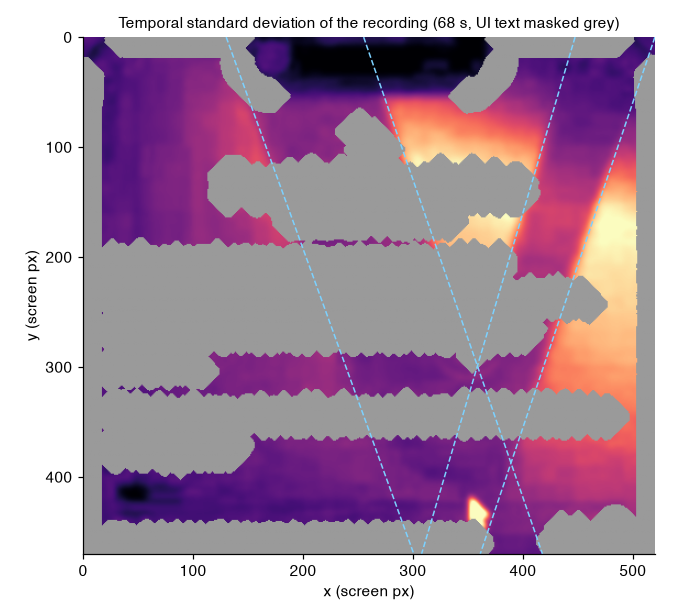
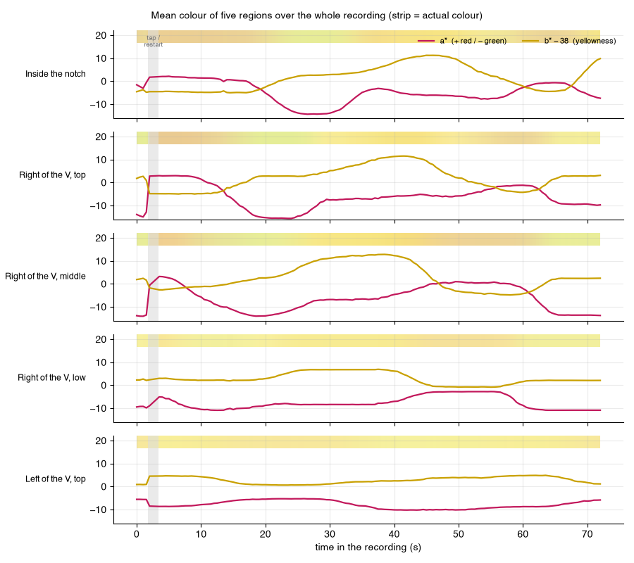
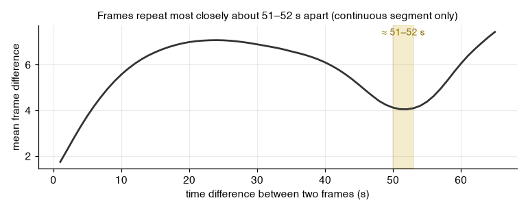
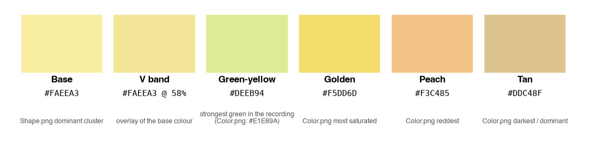
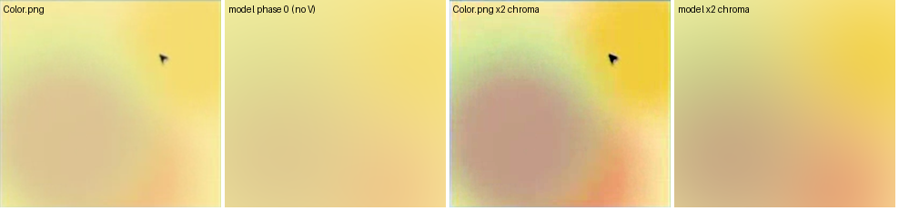
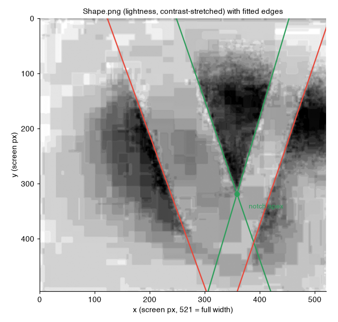
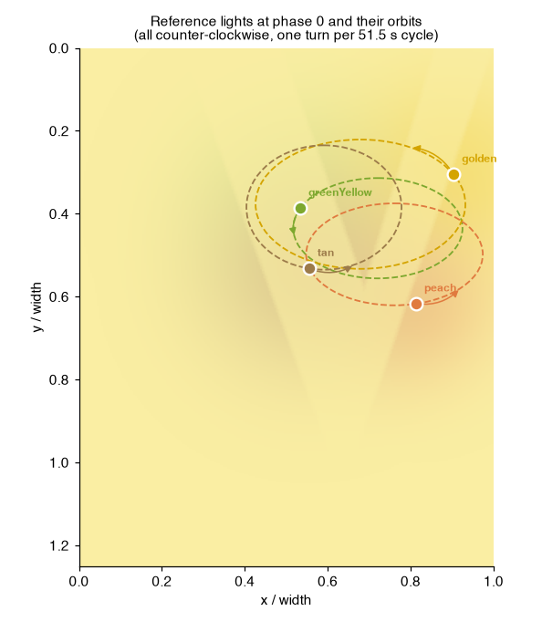

# Visual Analysis

This document records what was measured in the three reference files before any code was written, and the model that the package implements as a result. Every number here comes from the reference files themselves. Where something couldn't be measured, the document says so, and lists the assumption that was made instead.

- [Summary](#summary)
- [Reference materials and method](#reference-materials-and-method)
- [Animation-Video.mov](#animation-videomov)
- [Color.png](#colorpng)
- [Shape.png](#shapepng)
- [The starter implementation](#the-starter-implementation)
- [The model](#the-model)
- [SwiftUI drawing approach](#swiftui-drawing-approach)
- [Uncertainties and assumptions](#uncertainties-and-assumptions)

---

## Summary

The background has three layers:

1. **A pale butter base**, `#FAEEA3`, that fills the screen.
2. **Four soft coloured lights** (green-yellow, golden, peach, and tan) that each travel on their own ellipse around the middle of the V. They all move counter-clockwise and complete one turn in about **51.5 seconds**.
3. **A large, stationary, typographic V**: a filled shape with a thick left stroke and a thin right stroke. It's filled with the base colour at about **58% opacity**, so the lights show through it at roughly 40% strength. Its edges are slightly soft.

Nothing else moves. The V doesn't scale, drift, or fade, and there is no separate lighting effect. The impression of light comes from the glows passing behind the V and in and out of its notch.

| Property | Measured value | Source |
|---|---|---|
| Base colour | `#FAEEA3` (sRGB) | Shape.png, confirmed by the recording |
| V overlay | Base colour at 0.58 opacity (0.55–0.72 per channel) | Recording, regression across 9,438 edge samples |
| V edge softness | 10–90% transition of 6 px on a 521 px screen (about 4.5 pt on a 390 pt screen) | Recording and Shape.png |
| Thick and thin stroke widths | 0.23 and 0.12–0.14 of the screen width | Shape.png and the recording |
| Light colours | `#DEEB94`, `#F5DD6D`, `#F3C485`, `#DDC48F` | Color.png and the recording |
| Cycle length | 51.3–51.9 s across five independent fits; frames recur most closely 50–53 s apart | Recording |
| Direction | Counter-clockwise: colour enters at the lower right, climbs the right side, and crosses the notch | Recording |

---

## Reference materials and method

| File | Contents | Role |
|---|---|---|
| `Animation-Video.mov` | A 72-second screen recording of a phone mockup showing an app screen whose background uses this animation, with text on top | Behaviour: what moves, how, and how fast |
| `Color.png` | A 972 × 914 capture of the coloured layer, with no V and no text | Colour: palette and arrangement |
| `Shape.png` | A 1252 × 1190 capture of the top of the screen with the V, and no text | Geometry of the V |
| `AnimatedBackground.swift` | An initial SwiftUI implementation | Starting point only. Reviewed, but not reused |

Tools: `ffmpeg` and `ffprobe` to extract frames, ImageMagick for contrast stretching, macOS ColorSync (`sips`) for colour conversion, and Python with NumPy and SciPy for everything that was measured or fitted. All measurements are in **screen pixels of the recording**, where the phone screen is 521 px wide, unless they're given as a fraction of the width.

The animation is very subtle. Over the whole recording the background stays within about R 228–254, G 203–246, and B 118–178. To see anything, frames were:

1. **Cropped** to the phone's screen, which spans x = 84–605 and starts at y = 51 in the 678 × 670 recording.
2. **Cleaned of text** with a morphological closing (an 11 px max filter followed by a min filter). This removes thin dark strokes while keeping step edges such as the V's.
3. **Contrast-stretched** with the same fixed range for every frame, so frames can be compared. For colour, the difference from the base was amplified 3–4× in CIELAB, which keeps hues meaningful.

Frames were extracted at 1, 2, and 4 per second across the whole recording, 72, 145, and 289 frames respectively, not just the first few seconds.

---

## Animation-Video.mov

### The recording

| Property | Value |
|---|---|
| Size | 678 × 670 px |
| Duration | 72.33 s, 3,527 frames |
| Frame rate | Variable: a 120 fps time base, averaging 48.8 fps |
| Codec and colour | H.264, BT.709 |
| Visible screen | 521 px wide. Only the top 55% of the phone is in frame, and below y ≈ 470 px a card covers the background |

The recording isn't completely clean. Three things in it aren't part of the animation:

- **A scroll at 2.75–3.0 s.** The content scrolls up and back. These frames were excluded.
- **A tap at about 1.9 s, then an abrupt change.** Within a quarter of a second the right side changes from green to maroon. Everywhere else, colour changes take around ten seconds. The frames from 0–1.75 s match the frames exactly **20.00 s later** (frame distance 2.21–2.41, against a typical 0.25 s step of 1.14 and 5–7 between unrelated frames). The likely explanation is that the screen's animation restarted at about 1.9 s, having already run for about 18 s. The 70 s after the restart is continuous and is what the model is based on.
- **Touch indicators** at about 12–14 s and 37 s, with no visible effect on the background.

The background never responds to touch in any other way, so the package doesn't either.

### The V is stationary

The standard deviation of every pixel over the 68 continuous seconds shows the V as a crisp, dark band: colour barely changes inside it, but changes strongly in the notch and to its right. If the V moved, scaled, or faded, its edges would be blurred in this image. Instead, straight lines fit them with an RMS error of 1.0–1.5 px:

| Edge | Fitted line (screen px) | Angle from vertical |
|---|---|---|
| Left stroke, outer edge | `x = 0.370 y + 130` (Hough fit) | 20.3° |
| Left stroke, inner edge | `x = 0.3456 y + 252.7` | 19.1° |
| Right stroke, inner edge | `x = −0.3038 y + 446.8` | 16.9° |
| Right stroke, outer edge | `x = −0.3280 y + 515.5` | 18.2° |

The inner edges meet at the **notch apex, (356, 299)**. The outer edges meet below y = 470, where the card hides the background, so **the bottom of the V is never visible** in the recording.

### The V is a translucent layer of the base colour

If the V is a semi-transparent layer over the moving colour, then the colour just inside an edge should be a fixed mix of the colour just outside it and the V's own colour: `inside = (1 − α) · outside + α · C`. Pairs of samples 9 px either side of three edges, across every frame, fit that relationship well:

| Edge | Samples | α (R, G, B) | C (R, G, B) |
|---|---|---|---|
| Left inner | 715 | 0.74, 0.59, 0.63 | 251, 241, 159 |
| Right inner | 2,002 | 0.72, 0.59, 0.57 | 250, 242, 162 |
| Right outer | 6,721 | 0.71, 0.58, 0.59 | 249, 241, 160 |
| **All** | **9,438** | **0.72, 0.585, 0.59** | **249.6, 241.2, 160.5** |

The V's colour C is the background's base colour, and α is about 0.58 in the green and blue channels, which carry most of the variation. Along the right outer edge, α is the same from the top of the screen to the bottom (0.56, 0.55, 0.56, 0.58, and 0.50 in five bands), so **the V has no gradient**. Profiles across every edge are monotonic, with no bright rim, so **it has no highlight either**.

The edges are soft but not blurred: the transition takes **6.0 px from 10% to 90%** (median of 43 frames). That's about 4.5 pt on a 390 pt wide phone, or a Gaussian with a standard deviation of about 1.75 pt. Shape.png agrees (11–15 px of 1252, the same 1% of the width).

### What moves: coloured light, counter-clockwise, about every 51.5 seconds

Inside the notch and to the right of the V, the colour cycles through the same sequence again and again: **tan or mauve, then green-yellow, then golden, then peach, then tan again**. Each colour reaches the lower right first, climbs the right side, and only then crosses the notch:

| Colour wave | Lower right | Right, middle | Right, top | Notch |
|---|---|---|---|---|
| Green-yellow (lowest a\*) | ~12 s | ~22 s | ~23 s | ~26 s |
| Golden (highest b\*) | 26–38 s | ~38 s | ~40 s | ~45 s |

On screen that is counter-clockwise motion around the middle of the V. The left of the screen barely changes (its range is a few RGB units), because, as the model explains, the lights pass behind the thick left stroke there, which hides 58% of their colour.

How long is one turn? Three independent measurements agree:

1. **Recurrence.** Within the continuous segment, frames are most alike when they're **50–53 s apart** (mean difference 4.05, against about 7.0 for frames 20–30 s apart).

   

2. **A free orbital fit.** Six Gaussian lights, each on its own ellipse with its own period, fitted to every frame, all chose counter-clockwise motion, with periods of **49.6–54.2 s**.
3. **A shared-period fit.** Forcing a single period changes the fit error only from 3.07 to 3.14, and gives **51.8 s**. Later fits with the final colours gave 51.3–51.9 s.

The model uses **51.5 s**.

### Does the recording loop?

Not within its length. The continuous segment is 70 s, or 1.35 turns, and its first and last frames differ (frame distance 5.1). Frames 51–52 s apart are similar but not identical (4.05, against 1.14 for frames a quarter of a second apart), so the original's period is either longer than the recording or not exactly regular. The package's loop is exact by construction, as explained under [The model](#the-model). That's a design decision, not something the recording shows.

### Frame by frame

Each row describes the continuous segment, with times measured in the recording:

| Time | Notch | Right of the V | Left of the V |
|---|---|---|---|
| 4–12 s | Tan or mauve | Tan or mauve at the top, green low down | Faint peach |
| 16–24 s | Tan, with green arriving from the top right | Green | Faint peach |
| 24–32 s | Green-yellow | Green giving way to golden from below | Pale |
| 32–46 s | Golden, peaking at about 45 s | Golden | Pale |
| 46–56 s | Golden fading to mauve | Peach or salmon | Pale |
| 56–68 s | Mauve | Mauve, then green from below | Faint peach |
| 70–72 s | Golden arriving at the top right | Green | Faint peach |

### Strongest colours

The most saturated colours in the recording, averaged over the strongest 400 pixels of the notch and the right side, are close to the colours in Color.png:

| Light | Recording | Lab | Color.png | Lab |
|---|---|---|---|---|
| Golden | (245, 222, 116) | 88.4, −5.3, 54.0 | `#F5DD6D` | 88.1, −5.2, 57.1 |
| Tan or mauve | (232, 194, 142) | 80.5, 6.3, 31.0 | `#DDC48F` | 80.1, 1.3, 29.9 |
| Green-yellow | (222, 236, 148) | 90.6, −18.2, 41.1 | `#E1E89A` | 89.9, −14.2, 37.2 |
| Peach | (241, 213, 140) | 86.2, −0.2, 39.8 | `#F3C485` | 82.0, 8.9, 37.9 |

So the recording isn't washed out, and the lights reach their full colours. The recording's green is greener than anything in Color.png, which only catches the green light at the edge of its frame.

---

## Color.png

Color.png is tagged with the **Display P3** profile, like every macOS screenshot. Its values were converted to sRGB with ColorSync before measuring, because SwiftUI's `Color(red:green:blue:)` is sRGB. Without the conversion, every colour would be slightly off.

### Palette

A six-cluster k-means of every pixel (excluding the border and the mouse pointer):

| Colour | Share | Mean position (x, y) | Description |
|---|---|---|---|
| `#DEC793` | 34.1% | 0.33, 0.68 | Tan, the dominant colour |
| `#F1E99C` | 17.6% | 0.44, 0.30 | Pale cream |
| `#F5DD73` | 15.8% | 0.83, 0.24 | Golden |
| `#E0DC97` | 13.8% | 0.29, 0.43 | Green-beige |
| `#F2DE8B` | 10.8% | 0.75, 0.50 | Warm yellow |
| `#EDCA88` | 7.9% | 0.70, 0.84 | Peach |

The extremes are what the lights' centres look like:

| Extreme | Colour | Position |
|---|---|---|
| Most saturated | `#F5DD6D` | 0.94, 0.21 |
| Greenest | `#E1E89A` | 0.12, 0.27 |
| Reddest | `#F3C485` | 0.72, 0.92 |
| Darkest | `#DDC48F` | 0.32, 0.73 |
| Lightest | `#F8EBA3` | 0.43, 0.31 |

### Distribution

- **Blended, not separated.** There are no hard edges anywhere. Every colour fades smoothly into the next.
- **Radial, not linear.** The colours form round, soft regions: a large tan disc at the lower left, golden at the top right, green-yellow along the top left, and peach at the bottom right. Nothing suggests a linear gradient.
- **Layered.** The regions overlap and mix where they meet, as translucent glows do.
- **No transparency in the image itself.** The alpha channel is fully opaque.
- **Relative proportions.** Tan covers about a third of the image, cream and golden about a sixth each, and peach under a tenth.

### Where Color.png sits on the screen

Color.png contains no V. Its edges would cross any part of the upper screen, so it must be a capture of the coloured layer on its own. The arrangement of colours was compared with the model of the recording at every moment of the cycle:

- As a full-width capture, the best correlation is r = 0.42.
- As a **close-up about half the screen wide**, centred on the middle of the V (x ≈ 0.40–1.0, y ≈ 0.15–0.62 of the width), the correlation rises to **r = 0.73**, at about 40 s into the recording.

Read that way, Color.png's large tan disc sits right behind the thick left stroke, which is why the recording never looks strongly tan on the left. The model uses this moment as its starting point, so **frame 0 of the animation has Color.png's arrangement**: golden at the top right, green-yellow at the upper left, peach at the lower right, and tan at the lower left.

With the final parameters, Color.png's best framing falls at phase 0.993, so phase 0 is indeed Color.png's moment, and the model explains 71–73% of its variation. The model's lights are softer and slightly less saturated than Color.png's. The default peak opacity of 0.8 is a compromise between Color.png and the average of the recording, and `gradient.intensity` moves it either way.

---

## Shape.png

Shape.png is also Display P3, converted to sRGB before measuring. Its dominant colour (45% of pixels) is **`#FAEEA3`**, the base.

### Geometry

Each edge was found with a Hough-style search over slope and intercept for the strongest consistent edge in a lightness map. The results are converted to screen pixels by scaling 1252 → 521:

| Edge | Shape.png | Angle | Recording | Angle |
|---|---|---|---|---|
| Left outer | `x = 0.3630 y + 123.0` | 20.0° | `x = 0.370 y + 130` | 20.3° |
| Left inner | `x = 0.3460 y + 248.4` | 19.1° | `x = 0.3456 y + 252.7` | 19.1° |
| Right inner | `x = −0.2970 y + 453.2` | 16.5° | `x = −0.3038 y + 446.8` | 16.9° |
| Right outer | `x = −0.3380 y + 526.6` | 18.7° | `x = −0.3280 y + 515.5` | 18.2° |

Every angle agrees to within 0.5°, which confirms that Shape.png is a full-width capture of the same region. The intercepts differ only because Shape.png starts about 19.5 px higher. Shifting its lines down by that amount reproduces the recording's intercepts almost exactly: 130.1 against 130, 447.4 against 446.8. So **the angles and widths come from Shape.png, and the vertical position from the recording**, whose screen edges are known.

### What the V is

- **Straight edges.** Lines fit with an RMS error of 1.5–1.7 px over 600 px of length. There's no curvature.
- **A thick left stroke and a thin right stroke**, like a typographic V. Horizontally, the left stroke is 125 px wide at the top of the screen and 120 px at the notch apex. The right stroke is 73 px at the top and 61 px at the apex. The left stroke stays almost parallel, while the right one tapers slightly toward the bottom.
- **Off-centre.** The notch apex is at 69% of the width, and the bottom of the V would be at 64%.
- **A filled region, not a stroke.** The two strokes have different widths that change along their length, which a stroke can't do.
- **One layer, uniformly filled.** No second outline, no inner gradient, and no rim.
- **Beyond the top edge.** Both strokes run off the top of the screen. The right stroke leaves through the top-right corner.
- **The bottom is out of view.** The edges are only visible down to about y = 390–440 px, where the coloured light runs out. Extended, they meet at about (332, 556) px, at 49% of a 390 × 844 pt phone's height.

---

## The starter implementation

`AnimatedBackground.swift` was reviewed and none of its animation logic was reused. It differs from the references in almost every respect:

| Aspect | Starter implementation | References |
|---|---|---|
| V construction | A stroked path of two quadratic curves with round caps | A filled polygon with straight edges |
| V proportions | Symmetric and centred at 50% | A thick left stroke and a thin right one, off-centre at 64–69% |
| V position | From 2% to 68% of the height | From above the top of the screen to about 49% of the height |
| V appearance | A white-to-beige gradient at 65% opacity, blurred by 9% of the width | The base colour at 58%, with edges about 1.5 pt soft |
| V motion | Scales by up to 1.2% horizontally and 0.8% vertically | Stationary |
| Colours | Six generic pale yellows | Four distinct lights: green-yellow, golden, peach, and tan |
| Colour motion | Four gradients moving on small circles at 1×, 2×, and 3× speed over 30 s | Four lights on separate ellipses, all counter-clockwise, one turn per 51.5 s |
| Cost per frame | A blur of a whole-screen layer, every frame | Four gradient fills; the V is drawn once and isn't redrawn |
| Robustness | `colors[0...5]` read in two places that don't share the same guard | — |

Two ideas from it were worth keeping, and are implemented properly here: pausing when the scene isn't active, and honouring Reduce Motion. The background is also hidden from accessibility, as it was there.

---

## The model

### Coordinates

All geometry is in **design units**: fractions of the composition's width, measured from its top-left corner. A full-width portrait phone has a composition 1 unit wide, and its V reaches about 1.07 units down.

### Layers

For a point **p** and a phase φ in [0, 1):

1. Start with the base colour **B**.
2. For each light *k*, in order, composite its colour **c**ₖ over the result with opacity

   aₖ(**p**, φ) = Aₖ · g(|**p** − **m**ₖ(φ)| / σₖ),  where g(d) = e^(−d²/2)

   cut off at d = 3 and renormalised to reach exactly zero there.
3. Inside the V, composite **B** over the result with opacity α = 0.58, feathered across the edge.

### Motion

Each light's centre moves on an ellipse:

**m**ₖ(φ) = **o**ₖ + (rₓ cos θₖ(φ), r_y sin θₖ(φ)),  θₖ(φ) = θₖ,₀ − 2π nₖ φ

The y axis points down, so a decreasing θ is counter-clockwise on screen. nₖ is a whole number of turns per cycle, which is 1 for every reference light. Because every term returns to its starting value when φ goes from 0 to 1, **the animation's first and last frames are identical**, and the loop has no seam whatever the cycle length.

### Reference parameters

| Light | Colour | Orbit centre **o** | Radii (rₓ, r_y) | Start angle θ₀ | Size σ | Peak opacity A |
|---|---|---|---|---|---|---|
| Green-yellow | `#DEEB94` | 0.721, 0.435 | 0.204, 0.121 | −156.6° | 0.175 | 0.8 |
| Golden | `#F5DD6D` | 0.679, 0.377 | 0.253, 0.156 | −27.3° | 0.162 | 0.8 |
| Peach | `#F3C485` | 0.761, 0.498 | 0.213, 0.123 | 75.9° | 0.127 | 0.8 |
| Tan | `#DDC48F` | 0.591, 0.385 | 0.187, 0.150 | 101.0° | 0.172 | 0.8 |

Angles are measured clockwise from three o'clock, because the y axis points down. The cycle is **51.5 s**.

How these were found:

1. **Orbits and sizes** are the average of two fits that agreed closely. One fitted the recording alone, with the colours fixed. The other fitted the recording and Color.png together, with Color.png's framing free.
2. **Colours** come from Color.png's extremes, except green-yellow, which comes from the recording, where the green light is seen at its centre.
3. **The golden orbit** was moved 0.02 to the right, and its horizontal radius reduced by 0.02, so that its glow stays behind the thick stroke. That keeps the left of the screen calm, as it is in the recording. The fits couldn't see this region, because text covers most of it.
4. **Peak opacity** is 0.8. Least squares prefers about 0.6, because an imperfect spatial model trades peak colour for lower average error. The recording's strongest pixels, however, reach the full palette colours, which would need 1.0.
5. **Phase 0** is the moment that matches Color.png.

### The V

The V is the region between two pairs of straight lines. In design units, where u is across and v is down:

| Line | Equation | Crosses the top at |
|---|---|---|
| Left outer | u = 0.3630 v + 0.2497 | 0.2497 |
| Left inner | u = 0.3460 v + 0.4896 | 0.4896 |
| Right inner | u = −0.2970 v + 0.8587 | 0.8587 |
| Right outer | u = −0.3380 v + 0.9981 | 0.9981 |

The **outer vertex** is at (0.6372, 1.0676) and the **notch apex** at (0.6882, 0.5740). The V covers everything inside the outer triangle and outside the inner one, and it is extended upward so that it always runs off the top edge.

Soft edges come from drawing the polygon four times, offset from −0.58% to +0.58% of the width along each edge's normal. The copies are nested, and their opacities, 0.145, 0.170, 0.204, and 0.257 from the largest to the smallest, raise the coverage in four equal steps to exactly 0.58. Together they make a ramp about 1.15% of the width across, which matches the measured edge. [Animation Design](AnimationDesign.md#fill-and-soft-edges) derives the opacities.

---

## SwiftUI drawing approach

| Element | Implementation | Why |
|---|---|---|
| Clock | `TimelineView(.animation(minimumInterval:paused:))` with a small clock that keeps the phase continuous | Pauses cleanly, caps the frame rate, and is deterministic. A `repeatForever` animation can't be paused or retimed without a jump |
| Base and lights | One `Canvas`: a base fill and four radial gradient fills with 12 stops that follow a Gaussian | One layer and four fills per frame, with no offscreen passes |
| V | A `Shape` (`VShape`), drawn in a separate, static `Canvas` above the lights | It never changes, so it's rasterised once instead of every frame |
| Soft edges | Four offset copies of the polygon | Looks like a 1.75 pt blur, without the cost of a blur every frame |
| Layout | Positions in design units, scaled to the view's width and limited by its height | Keeps proportions on every device, with no screen sizes in the code |

---

## Uncertainties and assumptions

| Topic | What's known | Assumption |
|---|---|---|
| **The bottom of the V** | It's hidden by a card in the recording and out of frame in Shape.png | The straight edges continue to a point, at 49% of a phone's height |
| **The vertical position** | Shape.png's crop starts about 19.5 px higher than the recording's screen | Proportions come from Shape.png and the position from the recording |
| **The cycle** | 51.3–51.9 s from the fits and 50–53 s from recurrence, with no full repeat in the recording | 51.5 s, looping exactly |
| **The lower half of the screen** | Never visible | The base colour, which the model's lights don't reach |
| **The restart at 1.9 s** | Strongly suggested by the 20.00 s match, but not proven | It isn't something the background does, so it isn't implemented |
| **Light shape** | Gaussian glows fit well, but not perfectly | With the final parameters, the model explains 40%, 72%, and 42% of the variation in the recording's red, green, and blue channels at the default strength, and 53%, 75%, and 55% at `gradient.intensity = 0.75`. It explains 71–73% of Color.png, whose best match is at phase 0.993. It reproduces the timing, direction, and colours, not every frame |
| **Peak saturation** | Somewhere between the least-squares optimum (about 0.6) and the strongest observed colours (1.0) | 0.8, adjustable with `gradient.intensity`. Lower values match the recording's average more closely, and higher values match Color.png's peaks |
| **Colour accuracy** | Both PNGs were converted from Display P3. The recording went through H.264 | The PNGs' values are used wherever possible |
| **Pixel accuracy** | Edges are measured to within 1–2 px of the recording's 521 px screen | No claim of pixel-exact reproduction is made |
