<div align="center">

# 🌤️ AnimationBGView

<h3>A soft, living background for SwiftUI.</h3>

Pale-yellow light drifting behind a large translucent V, drawn entirely with SwiftUI.<br>
No images, no video, no dependencies. One line to add, and it loops forever without a seam.

[](https://github.com/tahirwaseempk90/AnimationBGView/actions/workflows/ci.yml)
[](https://github.com/tahirwaseempk90/AnimationBGView/tags)
[](https://www.swift.org)
[](#installation)
[](#platform-support)
[](Package.swift)
[](LICENSE)

<br>

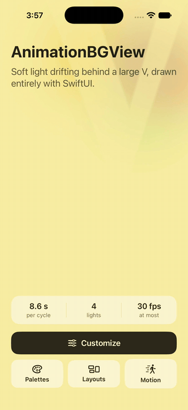

<sub>The example app on an iPhone 17 simulator, at 6× speed: one full cycle.</sub>

<br><br>

[Installation](#installation) · [Quick Start](#quick-start) · [Customization](#customization) · [Example App](#example-application) · [Documentation](#documentation)

</div>

---

## Contents

<table>
<tr>
<td valign="top" width="33%">

- [Why AnimationBGView?](#why-animationbgview)
- [Features](#features)
- [Preview Gallery](#preview-gallery)
- [Installation](#installation)
- [Requirements](#requirements)
- [Quick Start](#quick-start)
- [Basic Usage](#basic-usage)
- [Customization](#customization)

</td>
<td valign="top" width="33%">

- [How It Was Made](#how-it-was-made)
- [Example Application](#example-application)
- [Architecture](#architecture)
- [Package Structure](#package-structure)
- [Responsive Layout](#responsive-layout)
- [Accessibility](#accessibility)
- [Performance](#performance)
- [Testing](#testing)

</td>
<td valign="top" width="33%">

- [Platform Support](#platform-support)
- [Known Limitations](#known-limitations)
- [Roadmap](#roadmap)
- [Contributing](#contributing)
- [Versioning](#versioning)
- [Documentation](#documentation)
- [License](#license)
- [Author](#author)

</td>
</tr>
</table>

---

## Why AnimationBGView?

An animated background looks simple until you build one that people leave running:

- **Blur is expensive.** The obvious way to make soft colour, blurring shapes, costs an offscreen pass on every frame.
- **Loops jump.** A sequence of keyframes rarely ends exactly where it began, and a `repeatForever` animation snaps back to its start.
- **Time keeps going.** Change the speed of a clock-driven animation and the whole thing jumps, because all the elapsed time is suddenly multiplied by a new rate.
- **Screens differ.** A composition designed for a portrait phone stretches on an iPad, or disappears off the bottom of a phone in landscape.
- **Not everyone wants motion.** Reduce Motion, VoiceOver, and a backgrounded app all need handling.

AnimationBGView solves those once, with tests. It reproduces a specific reference animation, measured frame by frame, and gives you one line to use it.

---

## Features

<table>
<tr>
<td width="50%" valign="top">

### 🎨 Measured, not guessed

Colours, geometry, and timing were measured from the reference recording and images: four lights, a 51.5-second cycle, and a V whose edges match to within half a degree. See [Visual Analysis](Documentation/VisualAnalysis.md).

</td>
<td width="50%" valign="top">

### ♾️ A seamless loop

Every light makes a whole number of turns per cycle, so the last frame is the first. There's no restart, and changing the speed never jumps.

</td>
</tr>
<tr>
<td valign="top">

### 🪶 Light on resources

One `Canvas` pass per frame: a fill and four gradients, with no blur. The V is drawn once. 30 frames per second by default, and nothing at all while the app is inactive.

</td>
<td valign="top">

### 🧩 Configurable

Speed, travel, colour intensity, softness, palette, frame rate, the V's visibility, opacity, scale, and edge softness, and a still image at any phase.

</td>
</tr>
<tr>
<td valign="top">

### 📐 Responsive

Positions are relative to the width, so the V keeps its proportions on every iPhone and iPad, in portrait, in landscape, and in cards.

</td>
<td valign="top">

### ♿ Accessible

A still image when Reduce Motion is on, nothing for VoiceOver to read, and pausing while the scene isn't active.

</td>
</tr>
<tr>
<td valign="top">

### 🖼️ Pure SwiftUI

`TimelineView`, `Canvas`, `Path`, and gradients. No images, video, Lottie, or Metal. The V is also available as a `Shape`.

</td>
<td valign="top">

### 📦 SPM ready

Swift 6 with strict concurrency, no dependencies, and 102 package tests, including pixel-level rendering checks.

</td>
</tr>
</table>

---

## Preview Gallery

Every image here is the real package, captured from the [example app](#example-application) on iOS 27.2 simulators by [`Scripts/capture-screenshots.sh`](Scripts/capture-screenshots.sh).

### Through one cycle

The light moves counter-clockwise around the V. These are four still images, a quarter of a cycle apart:

<table>
<tr>
<td align="center" width="25%">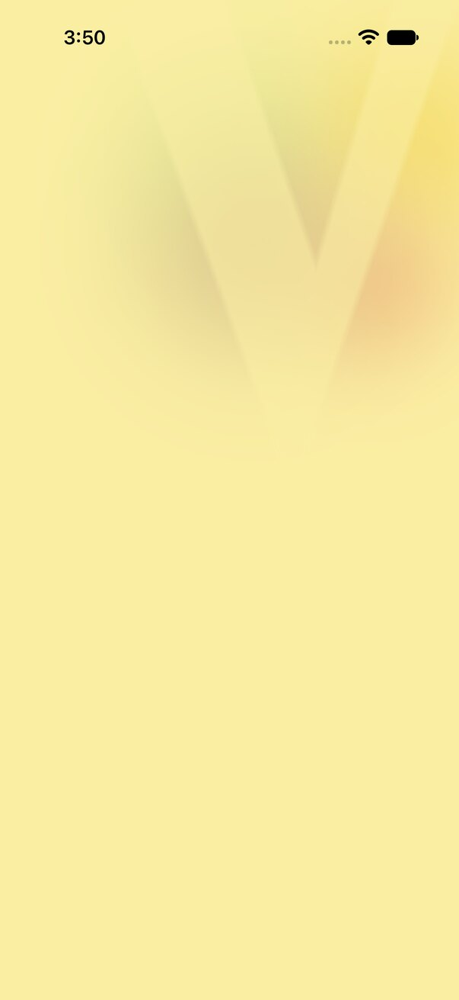<br><b>Phase 0</b><br>The arrangement of the colour reference</td>
<td align="center" width="25%">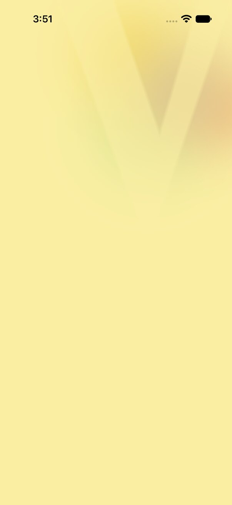<br><b>Phase 0.25</b></td>
<td align="center" width="25%">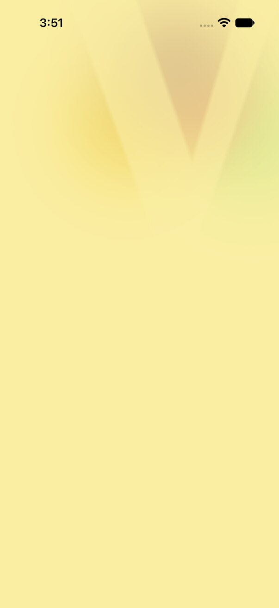<br><b>Phase 0.5</b></td>
<td align="center" width="25%">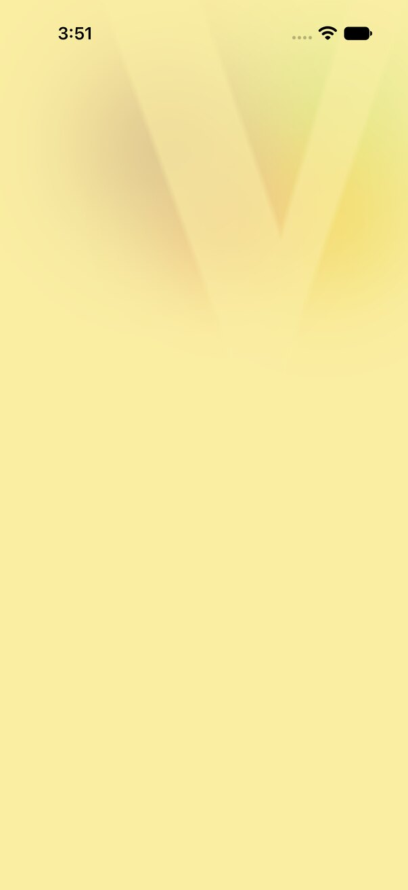<br><b>Phase 0.75</b></td>
</tr>
</table>

<p align="center">
  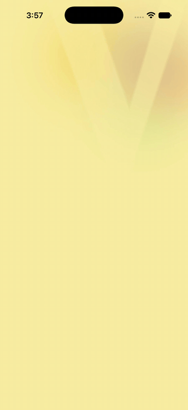
  <br><sub>The bare background, at 6× speed.</sub>
</p>

### Customization

<table>
<tr>
<td align="center" width="33%">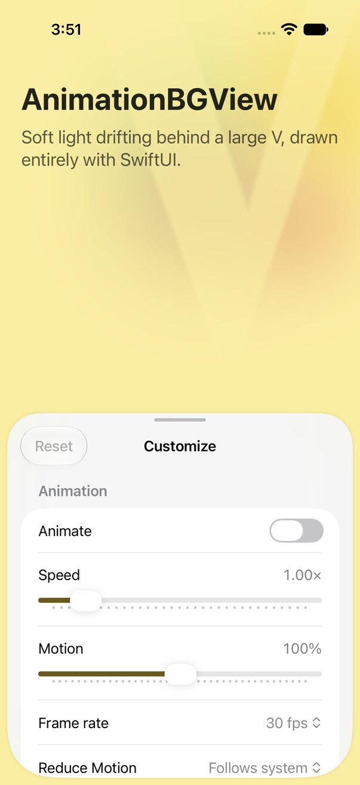<br><b>Live customization</b><br>Changes apply as you make them.</td>
<td align="center" width="33%">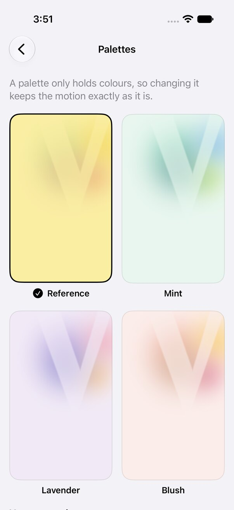<br><b>Palettes</b><br>New colours, the same motion.</td>
<td align="center" width="33%">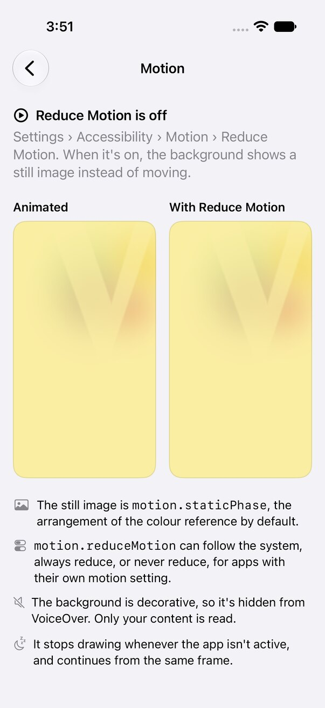<br><b>Reduce Motion</b><br>A still image instead of movement.</td>
</tr>
</table>

### Every screen

<table>
<tr>
<td align="center" width="25%">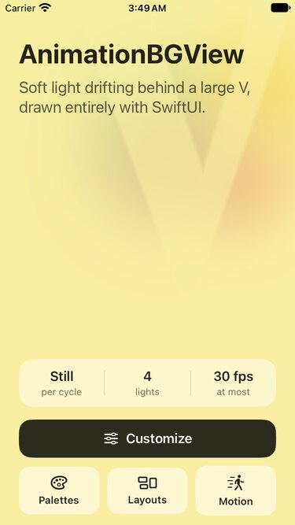<br><b>iPhone SE</b><br>375 × 667 pt</td>
<td align="center" width="25%">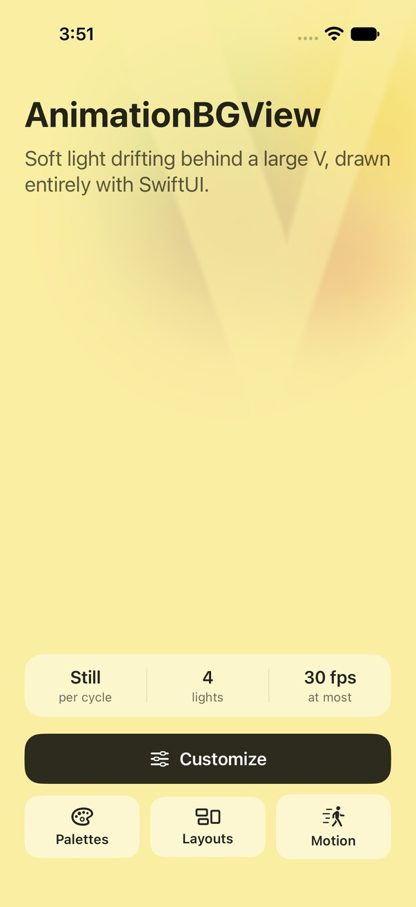<br><b>iPhone 17</b><br>402 × 874 pt</td>
<td align="center" width="25%">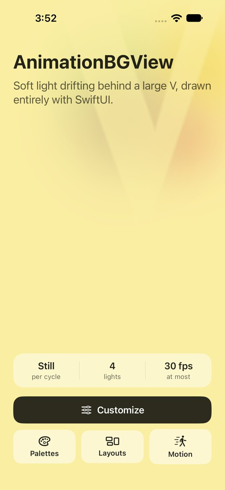<br><b>iPhone 18 Pro</b></td>
<td align="center" width="25%">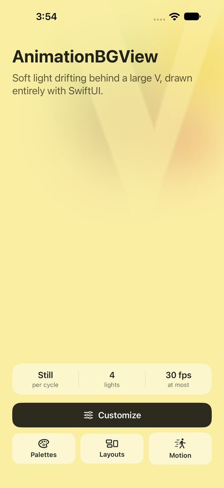<br><b>iPhone 18 Pro Max</b></td>
</tr>
</table>

<table>
<tr>
<td align="center" width="50%">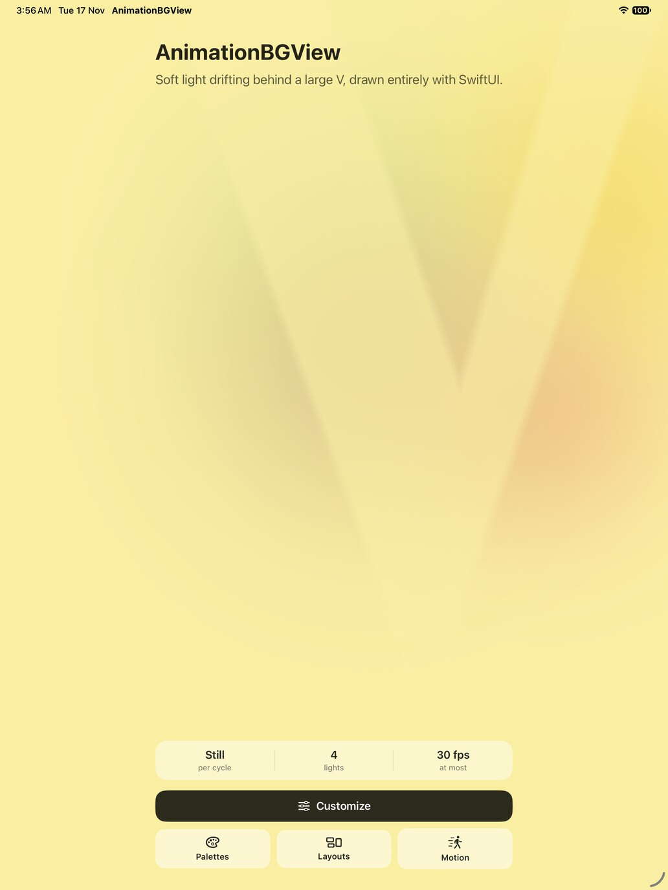<br><b>iPad Pro 13-inch, portrait</b></td>
<td align="center" width="50%">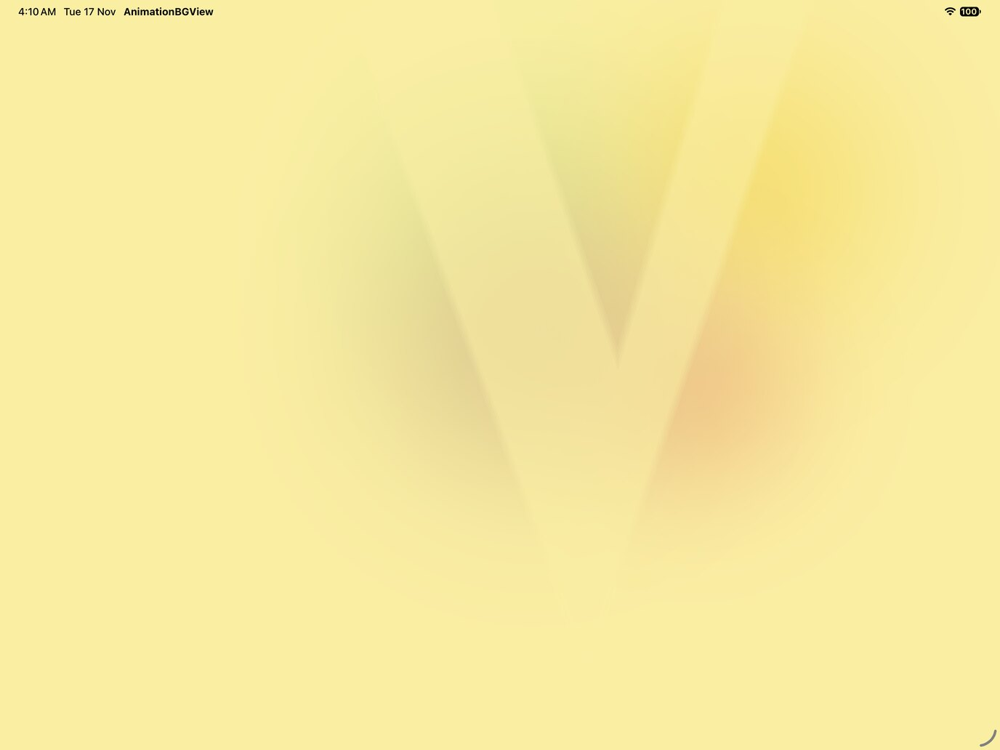<br><b>iPad Pro 13-inch, landscape</b><br>The composition fits the height and centres.</td>
</tr>
<tr>
<td align="center">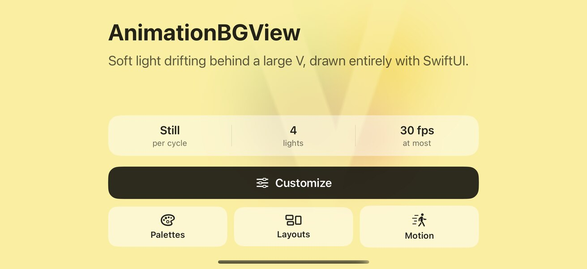<br><b>iPhone, landscape</b></td>
<td align="center">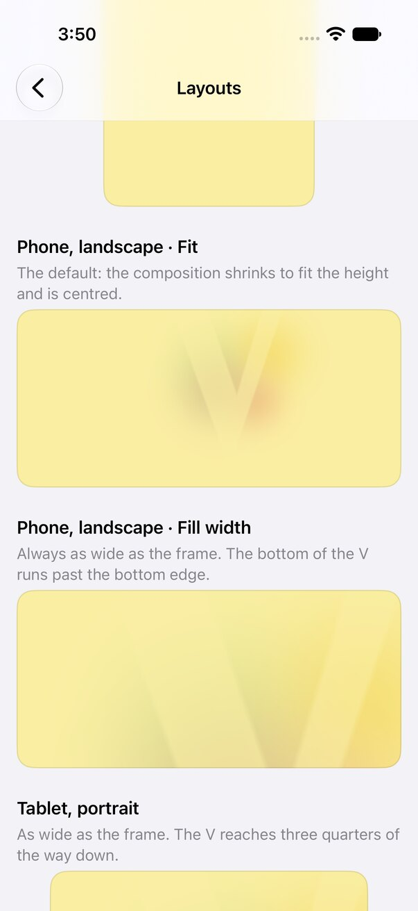<br><b>Fit and fill width</b><br>The two scaling modes on a short, wide frame.</td>
</tr>
</table>

---

## Installation

### Xcode

1. Choose **File > Add Package Dependencies**.
2. Enter the repository URL:

   ```text
   https://github.com/tahirwaseempk90/AnimationBGView
   ```

3. Choose a version rule. **Up to Next Major Version** from `1.0.0` is the usual choice.
4. Add the **AnimationBGView** library to your app target.

### Package.swift

```swift
dependencies: [
    .package(url: "https://github.com/tahirwaseempk90/AnimationBGView.git", from: "1.0.0")
],
targets: [
    .target(
        name: "MyFeature",
        dependencies: [.product(name: "AnimationBGView", package: "AnimationBGView")]
    )
]
```

### Local development

To work on the package and your app together, clone this repository and add it with **File > Add Package Dependencies > Add Local**, or in `Package.swift`:

```swift
.package(path: "../AnimationBGView")
```

---

## Requirements

| | Minimum |
|---|---|
| **iOS, iPadOS** | 16 |
| **macOS** | 13 |
| **Swift tools** | 6.0 |
| **Xcode** | 16 |
| **Dependencies** | None |

The library itself only needs iOS 15 APIs. iOS 16 is the minimum because that's what it's built and tested against: the test suite renders with `ImageRenderer`. See [Platform Support](#platform-support) for what has been run where.

---

## Quick Start

```swift
import AnimationBGView
import SwiftUI

struct WelcomeView: View {
    var body: some View {
        ZStack {
            AnimatedBackgroundView()

            VStack {
                Text("Welcome")
            }
        }
    }
}
```

That's all. The background fills the screen, extends under the status bar and home indicator, and starts moving.

---

## Basic Usage

```swift
// Full screen, behind your content.
ZStack {
    AnimatedBackgroundView()
    content
}

// As a background modifier.
content
    .background { AnimatedBackgroundView() }

// Inside a card, keeping to the card's frame.
var card = AnimatedBackgroundConfiguration.default
card.ignoresSafeArea = false

AnimatedBackgroundView(configuration: card)
    .frame(height: 220)
    .clipShape(RoundedRectangle(cornerRadius: 24))

// A still image, with no animation.
AnimatedBackgroundView(configuration: .static)
```

---

## Customization

Start from `.default` and change only what you need:

```swift
var configuration = AnimatedBackgroundConfiguration.default
configuration.motion.speed = 1.5            // Faster.
configuration.motion.intensity = 0.8        // The lights travel less far.
configuration.gradient.intensity = 0.7      // Softer colours.
configuration.vShape.opacity = 0.45         // A fainter V.

AnimatedBackgroundView(configuration: configuration)
```

A configuration is a plain value. Keep it in `@State` and bind controls straight to it:

```swift
@State private var configuration = AnimatedBackgroundConfiguration.default

Slider(value: $configuration.motion.speed, in: 0...4)
Toggle("Show V", isOn: $configuration.vShape.isVisible)
```

### Colour palette

A palette only holds colours, so replacing it keeps the motion exactly as it is. Light `n` takes colour `n`, and colours repeat if there are fewer than four.

```swift
configuration.palette = BackgroundColorPalette(
    base: Color(red: 0.91, green: 0.97, blue: 0.94),
    lights: [.mint, .teal, .cyan, .green]
)

// The V is the base colour unless you choose another.
configuration.palette.vShape = .white
```

The reference palette, measured from the reference images:

<p align="center">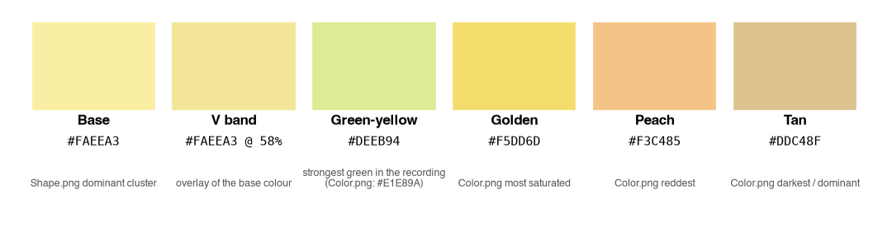</p>

### Animation

```swift
configuration.motion.cycleDuration = 40     // Seconds per cycle at normal speed.
configuration.motion.speed = 2              // Changing speed never jumps.
configuration.motion.frameRate = 60         // The highest frame rate. The default is 30.
configuration.motion.isEnabled = false      // A still image of staticPhase.
configuration.motion.staticPhase = 0.25     // Which still image, and where animation starts.
configuration.motion.reduceMotion = .always // Or .followsSystem (default), or .never.
```

### V shape

```swift
configuration.vShape.isVisible = false
configuration.vShape.opacity = 0.7
configuration.vShape.scale = 1.2            // Around its middle. The strokes still reach the top.
configuration.vShape.edgeSoftness = 0       // Crisp edges.
```

The V is also a standalone, animatable `Shape`:

```swift
VShape(scale: isExpanded ? 1.2 : 1)
    .fill(.white.opacity(0.6))
    .animation(.spring, value: isExpanded)
```

### Lights

```swift
configuration.gradient.intensity = 1.25     // Stronger colours.
configuration.gradient.softness = 1.4       // Larger, more diffuse glows.

// Or describe your own lights.
configuration.gradient.lights = [
    GradientLight(
        orbitCenter: CGPoint(x: 0.5, y: 0.4),
        orbitRadii: CGSize(width: 0.25, height: 0.12),
        startAngle: .degrees(0),
        size: 0.16,
        peakOpacity: 0.8
    )
]
```

### Configuration reference

| Property | Description | Default |
|---|---|---|
| `palette` | Colours | `.reference` |
| `motion` | Speed, cycle length, travel, frame rate, still phase, Reduce Motion behaviour | `.default` |
| `vShape` | The V's visibility, opacity, scale, edge softness, and geometry | `.default` |
| `gradient` | The lights, and their intensity and softness | `.default` |
| `scaling` | `.fit` or `.fillWidth` | `.fit` |
| `ignoresSafeArea` | Whether the background extends under the safe areas | `true` |

<details>
<summary><b>Motion</b>: <code>motion</code></summary>

<br>

| Property | Description | Range | Default |
|---|---|---|---|
| `isEnabled` | Whether the background moves | | `true` |
| `cycleDuration` | Seconds per cycle at normal speed | 1–3,600 | `51.5` |
| `speed` | A playback-rate multiplier. `0` holds the frame | 0–20 | `1` |
| `intensity` | How far the lights travel | 0–2 | `1` |
| `frameRate` | The highest frames per second | 1–120 | `30` |
| `staticPhase` | The still image, and the starting frame | | `0` |
| `reduceMotion` | `.followsSystem`, `.always`, or `.never` | | `.followsSystem` |
| `pausesWhenInactive` | Stop drawing while the scene isn't active | | `true` |

</details>

<details>
<summary><b>V</b>: <code>vShape</code></summary>

<br>

| Property | Description | Range | Default |
|---|---|---|---|
| `isVisible` | Whether the V is drawn | | `true` |
| `opacity` | The fill's opacity | 0–1 | `0.58` |
| `scale` | The size, around the V's middle | 0.25–3 | `1` |
| `edgeSoftness` | The fade across each edge, as a fraction of the width | 0–0.1 | `0.0115` |
| `geometry` | The V's proportions and position | | `.reference` |

</details>

<details>
<summary><b>Lights</b>: <code>gradient</code></summary>

<br>

| Property | Description | Range | Default |
|---|---|---|---|
| `lights` | The lights' paths, sizes, and opacities | | Four reference lights |
| `intensity` | Multiplies every light's opacity | 0–2 | `1` |
| `softness` | Multiplies every light's size | 0.25–3 | `1` |

</details>

Values outside a range are clamped when the background draws, and non-finite values fall back to the defaults. Every public type is in the [API reference](Documentation/APIReference.md).

---

## How It Was Made

The reference was a 72-second screen recording and two still captures. Before any code was written, they were measured with `ffmpeg`, ImageMagick, and Python. The full findings are in [Visual Analysis](Documentation/VisualAnalysis.md).

| Finding | How it was established |
|---|---|
| **The V is stationary** and filled with the base colour at about 58% | A per-pixel temporal standard deviation over 68 seconds shows crisp, unmoving edges, and a regression across 9,438 edge samples gives the overlay |
| **The V is typographic**: a thick left stroke and a thin right one, off-centre | Straight-line fits to both references agree to within 0.5° |
| **Four coloured lights circle counter-clockwise** | Each colour reaches the lower right first, climbs the right side, then crosses the notch. Orbital fits all chose counter-clockwise motion |
| **One turn takes about 51.5 seconds** | Five independent fits gave 51.3–51.9 s, and frames recur most closely 50–53 s apart |
| **Phase 0 is the colour reference's arrangement** | Color.png matches the model best as a close-up of the V's middle (r = 0.73), at the moment the animation starts from |

<table>
<tr>
<td width="50%">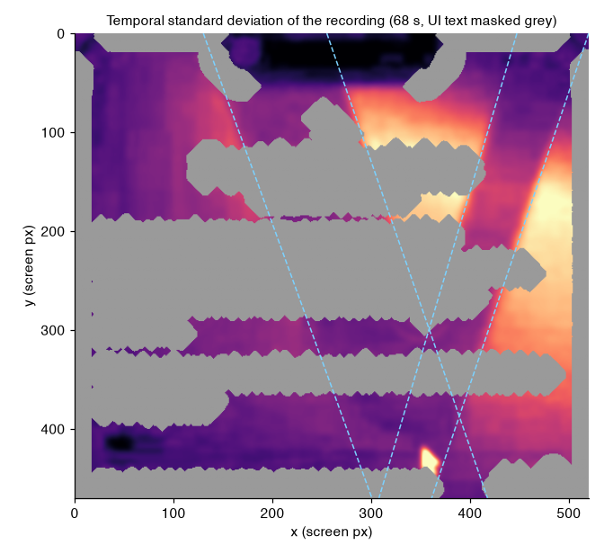</td>
<td width="50%">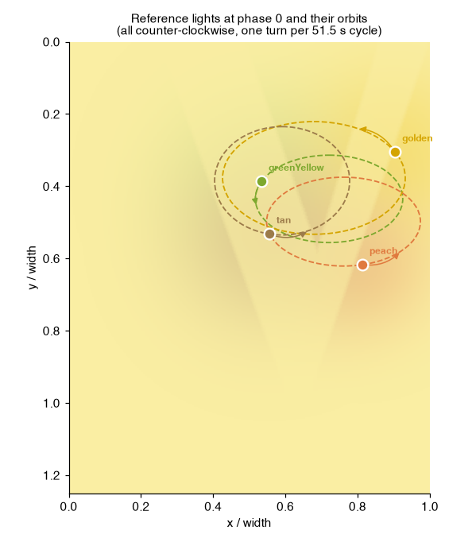</td>
</tr>
</table>

---

## Example Application

[`Example/`](Example/README.md) is a complete SwiftUI app. It uses the package through a local Swift Package reference, so it builds against the code in this repository, and it contains no drawing code of its own.

```sh
git clone https://github.com/tahirwaseempk90/AnimationBGView.git
open AnimationBGView/Example/AnimationBGViewExample.xcodeproj
```

Choose the `AnimationBGViewExample` scheme and an iPhone or iPad simulator, then run. No signing setup is needed.

| Screen | What it shows |
|---|---|
| **Home** | The background full screen, under a title and controls |
| **Customize** | Every setting, applied live, with a reset. The panel opens at half height, so the V stays in view |
| **Palettes** | The same motion in four palettes |
| **Layouts** | Phone, tablet, card, and banner frames, with both scaling modes |
| **Motion** | The animation next to what people with Reduce Motion see |

At **Speed** 6×, a whole cycle plays in under nine seconds, which makes it easy to compare with a recording.

---

## Architecture

A configuration describes what to draw, a clock turns time into a phase, pure functions turn a phase and a size into shapes, and two `Canvas` views draw them.

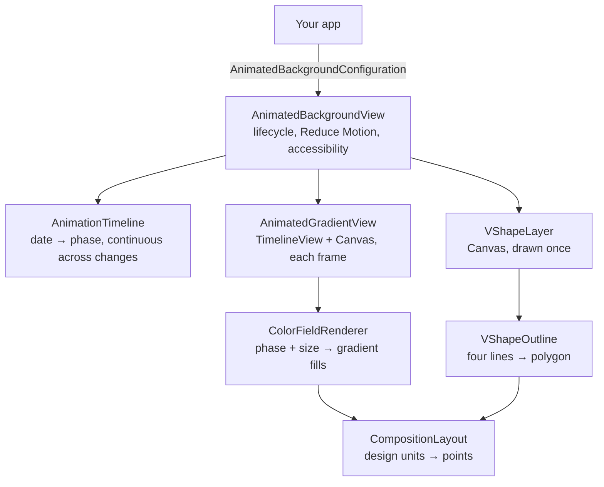

| Decision | Why |
|---|---|
| **`TimelineView` + `Canvas`** | One drawing pass per frame, a frame-rate cap, clean pausing, and deterministic frames that tests can render |
| **Gaussian gradients, not blur** | Soft light without an offscreen pass |
| **The V in a static layer** | It never moves, so it's drawn once |
| **A continuous clock** | Changing speed, pausing, or turning animation back on never jumps |
| **Design units** | Proportions hold on every screen, with no device sizes in the code |
| **No view model** | The view is a function of a value and a date |

Read the [architecture guide](Documentation/Architecture.md) for the reasoning, including the alternatives that were rejected, and [Animation Design](Documentation/AnimationDesign.md) for the geometry and the loop.

---

## Package Structure

```text
AnimationBGView/
├── Package.swift
├── Sources/AnimationBGView/
│   ├── AnimatedBackgroundView.swift      The view
│   ├── Animation/                        Motion settings, phase, continuous clock
│   ├── Colors/                           Palette
│   ├── Gradients/                        Lights, Gaussian falloff, the animated canvas
│   ├── Layout/                           Design units → points
│   ├── Shapes/                           The V: shape, geometry, outline, static layer
│   └── Utilities/
├── Tests/AnimationBGViewTests/           Unit, rendering, snapshot, and performance tests
├── Example/                              The example app and its UI tests
├── Documentation/                        Guides and analysis figures
├── Screenshots/                          Images captured from the example app
├── Reference/                            The reference images and starter code
├── Scripts/                              Build, test, and screenshot tools
└── .github/                              CI
```

---

## Responsive Layout

The background fills whatever frame it's given. Everything is positioned in *design units*, fractions of the composition's width, so the V keeps its proportions everywhere:

| Frame | With `.fit` (default) | With `.fillWidth` |
|---|---|---|
| **Phone, portrait** | As wide as the screen; the V reaches about halfway down | The same |
| **iPad, portrait** | As wide as the screen; the V reaches about three quarters of the way down | The same |
| **Short and wide**, such as a phone in landscape | Shrinks to fit the height and centres, so the whole V shows | As wide as the frame; the bottom of the V runs off the bottom edge |
| **Card or banner** | Shrinks to fit, centred | As wide as the card |

There's no device-specific code and no use of `UIScreen`. The images in the [gallery](#preview-gallery) come from an iPhone SE, an iPhone 17, an iPhone 18 Pro, an iPhone 18 Pro Max, and a 13-inch iPad Pro, in portrait and landscape. Snapshot tests cover frames from 320 × 320 up to 1,180 × 820.

> [!TIP]
> Set `ignoresSafeArea = false` when the background is inside a card, so it keeps strictly to the card's frame.

---

## Accessibility

- **Reduce Motion.** With Reduce Motion on, the background shows a still image, `motion.staticPhase`, instead of moving. Apps with their own motion setting can use `motion.reduceMotion = .always` or `.never`.
- **VoiceOver.** The background is decorative and hidden from accessibility. A UI test checks that it gives VoiceOver nothing to read or focus, and runs Apple's accessibility audit for element descriptions on the example's home screen.
- **Not in the way.** The background doesn't take touches from the controls above it, which a UI test checks.
- **Contrast.** The palette is pale, so dark text reads well over it. Check the contrast of your own content, especially with custom palettes.

---

## Performance

| | |
|---|---|
| **Per frame** | One `Canvas` pass: a fill and four radial gradients. No blur, no offscreen passes |
| **The V** | Drawn once, and redrawn only when its configuration or size changes |
| **Frame rate** | 30 by default. The motion is slow, so this is as smooth as 60 |
| **When inactive** | Nothing is drawn while the scene is inactive or in the background, or when a still image is showing |

CPU use of the example app in the iPhone 17 simulator, on an Apple silicon Mac:

| State | CPU |
|---|---|
| Animating at 15 / 30 / 60 fps | ≈ 3% / 6% / 9–10% |
| Still image | 0% |
| In the background | 0% |

These are simulator figures, which show relative cost, not what a phone uses. The background hasn't been profiled on a physical device. See [Performance](Documentation/Performance.md) for the details and recommendations.

---

## Testing

```sh
swift test                 # 102 package tests on macOS
Scripts/test.sh            # The same, plus the package tests on an iOS simulator
Scripts/test.sh --ui       # And the example app's UI tests
swiftlint lint --strict    # Lint
```

| Tests | What they cover |
|---|---|
| **Geometry** | The V's corners, angles, and stroke widths against the measurements; path bounds and containment in different frames; invalid geometry; scaling and edge softening |
| **Colour** | The reference palette against the measured values; each colour's role; custom palettes and repeating colours |
| **Animation** | Phase wrapping, elapsed time, the loop boundary, the continuous clock through speed changes, pauses, and still images, and running for days |
| **Configuration** | Defaults, presets, clamping, and non-finite input |
| **Rendering** | The real view rendered with `ImageRenderer` and checked pixel by pixel: full coverage, the base colour, the V's 58% overlay, proportions at three sizes, both scaling modes, soft edges, no mirroring in right-to-left layouts, an identical frame one cycle later, and no jumps in 120 frames around the whole cycle |
| **Snapshots** | 14 reference images per platform, with no snapshot library |
| **UI** | Six tests of the example app: content over the background, accessibility, live customization with reset, navigation, palettes, and rotation |

All of these pass on macOS 27.2 and on the iOS 27.2 simulator. [CI](.github/workflows/ci.yml) builds with warnings as errors, runs the tests on macOS and on an iOS simulator, runs the UI tests, checks the example project, builds with Swift 6.1, and lints.

---

## Platform Support

| Platform | Declared minimum | Tested on |
|---|---|---|
| **iOS** | 16 | iOS 27.2 simulators: iPhone SE (3rd generation), iPhone 17, iPhone 18 Pro, iPhone 18 Pro Max |
| **iPadOS** | 16 | iPadOS 27.2 simulator: iPad Pro 13-inch (M5) |
| **macOS** | 13 | macOS 27.2, and the CI runners' macOS |

> [!IMPORTANT]
> Testing has been on simulators and a Mac, not physical devices. iOS 16 through 26 haven't been run: no older simulator runtimes were available. The code only uses APIs available in the declared minimums, which the compiler checks. Snapshot comparisons only run on OS 27; elsewhere they skip.

Mac Catalyst, tvOS, watchOS, and visionOS aren't declared, because they haven't been tested.

---

## Known Limitations

- **The bottom of the V was never visible** in the references, so its pointed tip is an extrapolation of the straight edges.
- **The lights are a model.** Four Gaussian glows on ellipses reproduce the reference's timing, direction, and colours, but not every frame. With the defaults the model explains 40–72% of the colour variation in the recording, depending on the channel.
- **The reference doesn't contain a complete loop.** The 51.5-second exact loop is a design decision, based on the measured period.
- **Colour strength is a compromise** between the recording and the colour reference. `gradient.intensity` moves it either way.
- **No physical-device profiling yet**, so battery and thermal behaviour haven't been measured.
- **A covered background keeps its timeline.** If the background stays in the hierarchy under another screen, it may keep drawing. Turn `motion.isEnabled` off while it's covered if that matters.
- **No dark appearance.** The reference is a light design. Supply your own palette for dark mode.

---

## Roadmap

These are ideas, with no dates. **None of them is implemented yet.**

- [ ] Pause automatically while the view is covered or off screen
- [ ] Lower the frame rate in Low Power Mode
- [ ] A dark palette preset
- [ ] More palette presets
- [ ] Profiling on physical devices
- [ ] visionOS and Mac Catalyst support, once tested

---

## Contributing

Contributions are welcome. [Fork the repository](https://github.com/tahirwaseempk90/AnimationBGView/fork), then:

```sh
git clone https://github.com/YOUR_USERNAME/AnimationBGView.git
cd AnimationBGView
git checkout -b my-change
swift build
swift test
swiftlint lint --strict
```

Push your branch and open a pull request against `main`. Keep the public API small, keep drawing pure and the loop seamless, add no dependencies, and give every behaviour change a test. Read [CONTRIBUTING.md](CONTRIBUTING.md) for the full expectations, including how to record snapshots.

---

## Versioning

The package follows [Semantic Versioning](https://semver.org):

| Change | Version | For example |
|---|---|---|
| **Major** | `2.0.0` | Removing public API, or raising a minimum platform |
| **Minor** | `1.1.0` | A new configuration option with a default value |
| **Patch** | `1.0.1` | A fix that doesn't change the API |

Every release is recorded in [CHANGELOG.md](CHANGELOG.md).

---

## Documentation

| Guide | What's in it |
|---|---|
| [Visual Analysis](Documentation/VisualAnalysis.md) | What was measured in the references, and the model that resulted |
| [Animation Design](Documentation/AnimationDesign.md) | How the V and the lights are built, and how the loop stays seamless |
| [Architecture](Documentation/Architecture.md) | How it works, and why |
| [API Reference](Documentation/APIReference.md) | Every public type, with ranges and defaults |
| [Performance](Documentation/Performance.md) | What a frame costs, measurements, and recommendations |

The public API also has documentation comments and a DocC catalog. In Xcode, choose **Product > Build Documentation**.

---

## License

AnimationBGView is available under the [MIT license](LICENSE).

## Acknowledgements

Built with [SwiftUI](https://developer.apple.com/xcode/swiftui/). The example project is generated with [XcodeGen](https://github.com/yonaskolb/XcodeGen), and the code is checked with [SwiftLint](https://github.com/realm/SwiftLint).

## Support

Found a bug or have an idea? [Open an issue](https://github.com/tahirwaseempk90/AnimationBGView/issues/new). To report a security problem, follow the [security policy](SECURITY.md).

## Author

Created and maintained by [Tahir Waseem](https://github.com/tahirwaseempk90).

<div align="center">
<br>

**If AnimationBGView is useful to you, a ⭐ helps others find it.**

</div>
